# 10 个热门旅游城市：景点口碑的真实规律

> 用 Python 爬取去哪儿网 **455 个真实景点**数据，回答一个具体问题：
> **门票越贵，景点就越值得去吗？**

📝 **技术复盘文章（CSDN）**：[一次景点数据爬取复盘：从 499 条到 455 条，我剔掉的 8.8% 脏数据](https://blog.csdn.net/2401_86734821/article/details/167659876)

---

## 问题

旅游平台上，每个景点都有评分和评论数。作为游客，我们想问的是：

1. **门票价格和口碑有关系吗？**（贵的景点真的更好？）
2. **哪个城市的景点"口碑最稳"？**
3. **"热度高"的景点评价就更好吗？**

为了回答这些，我采集了 10 个热门旅游城市的景点数据。

---

## 数据

| 项目 | 说明 |
|---|---|
| 来源 | 去哪儿网（piao.qunar.com），**真实爬取，非模拟数据** |
| 规模 | 原始 499 条 → 清洗后 **455 条** × 10 城市 × 24 字段 |
| 字段 | 评分、评论数、门票价格、标签、景区等级、地址、简介等 |
| 采集方式 | Python `requests` 解析列表页 + 详情页，调用**评论 API** 获取真实用户评论 |

**城市分布**：北京 50、武汉 50、成都 50、西安 50、重庆 47、上海 45、青岛 44、杭州 42、济南 39、南京 38

---

## ⭐ 数据质量问题：我剔除掉了 8.8% 的"假数据"

这是本项目**最值得说的部分**。

### 问题 1：跨城市污染（44 条 / 8.8%）

爬取过程中发现：网站的"相关推荐"链接会污染列表页，导致**非本地景点被错误归到某城市**。
例如济南的数据里混进了泰山、故宫、八达岭长城，杭州的数据里混进了兵马俑、黄鹤楼。

**检出与处理**：
- 建立「地标 → 真实城市」映射表（40+ 个知名地标）
- 检测名称与实际归属不符的记录
- **检出 44 条污染数据（占 8.8%），全部剔除**

| 受影响城市 | 污染条数 |
|---|---|
| 南京 | 11 |
| 济南 | 11 |
| 杭州 | 8 |
| 青岛 | 6 |
| 上海 | 5 |
| 重庆 | 3 |

### 问题 2：伪零分（13 条）——缺失被编码成"0 分"

清洗过程中发现一批 **评分为 0** 的记录，进一步检查发现它们有个共同特征：
**评论数也为 0**。也就是说，这些景点不是"评价很差"，而是**从未被任何人评价过**，
平台把"无评分"错误地伪编码成了 `0`。

> 这类记录如果不处理，会**严重拉低城市均分**、污染"价格—口碑关系"等所有下游结论。

**处理方式**：将「评分 = 0 且评论数 = 0」置为缺失，再按城市均值填补。

**修正前后对比（影响显著）**：

| 指标 | 修正前 | 修正后 |
|---|---|---|
| 评分范围 | 0.00 ~ 5.00 ❌ | **1.00 ~ 5.00** ✅ |
| 全网平均分 | 4.40（被拉低） | **4.53** |
| 城市均分第一名 | 南京 4.61 | **上海 4.62**（南京降至第二） |
| 价格-评分相关系数 | -0.03 | **-0.163**（方向更清晰） |

> 如果不清洗这两批数据，后续所有"城市排名"与"价格-口碑"结论都是错的。
> 清洗脚本见 [`src/clean.py`](src/clean.py)，质量报告见 `data/processed/quality_report.txt`。

---

## 3 个关键发现

> ⚠️ 以下统计均基于**完成两轮清洗后**的 455 条数据（剔除污染 + 修正伪零分）。

### 发现 1：门票价格与口碑**几乎没有关系**

- 价格与评分的皮尔逊相关系数 = **-0.163**（弱负相关，方向为"越贵口碑略低"）
- 免费景点平均分 **4.53**，收费景点平均分 **4.57**
- 独立样本 t 检验：**p = 0.709 > 0.05，差异不显著**

> **结论**：贵的门票**买不到**更好的口碑。免费景点（如西湖、外滩、天安门）的口碑并不比收费景点差。
> 这跟"一分钱一分货"的直觉相反——对游客来说是个有用的信号。
> 值得注意的是：**即使在修正了 13 条伪零分数据之后，这个结论依然成立**（p = 0.709），说明它足够稳健。

### 发现 2：热度高 ≠ 评价好

- 评论数与评分的相关系数 = **0.151**（极弱正相关）

> **结论**：评论多的景点不一定评分高。热度反映的是"知名度"，不是"满意度"。
> 有些景点人很多，纯粹因为它是地标，而不是因为它好玩。

### 发现 3：各城市口碑差异明显

| 城市 | 景点数 | 平均评分 |
|---|---|---|
| **上海** | 45 | **4.62** |
| 南京 | 38 | 4.61 |
| 成都 | 50 | 4.59 |
| 北京 | 50 | 4.57 |
| 杭州 | 42 | 4.55 |
| 青岛 | 44 | 4.53 |
| 济南 | 39 | 4.49 |
| 武汉 | 50 | 4.49 |
| 重庆 | 47 | 4.47 |
| **西安** | 50 | **4.42** |

> **结论**：上海、南京、成都的景点口碑整体最高，西安相对靠后。
> 注意——**这个排名受数据质量影响，仅供参考**（见局限性）。

---

## 方法与技术栈

```
数据采集  →  requests + 反爬处理（UA 池/重试）+ 评论 API
数据清洗  →  pandas（跨城市污染检测 / 伪零分修正 / 缺失值 / 去重 / 派生字段）
可视化    →  matplotlib + seaborn（箱线图/小提琴图/热力图/气泡图）
```

**运行方式**：

```bash
pip install -r requirements.txt
python src/clean.py        # 第 1 步：清洗（污染检测 + 伪零分修正）
python src/visualize.py    # 第 2 步：基于清洗结果生成图表
```

> 职责分离：`clean.py` 只做数据清洗，`visualize.py` 只读清洗后的数据作图。
> 这样改清洗规则不会污染绘图逻辑，改图也不用重跑爬虫。

**关于图 04 的补充说明**：
散点图中的相关系数 **r = -0.442** 是在「有价格的 36 条子集」内计算的；
在全量 455 条数据上（无价格记为 0 的样本会稀释信号）此系数为 **-0.163**。
两者都指向"价格与口碑无正向关系"，但基于 36 条的强相关**不要过度解读**。

---

## ⚠️ 局限性（诚实说明）

1. **价格数据严重不完整**：455 条中仅 36 条有有效价格（南京为主），
   其他城市的价格字段大量缺失。**因此"价格与口碑无关"的结论应谨慎对待**，
   真实结论需要更完整的价格数据支撑。
2. **单一平台偏差**：数据仅来自去哪儿网，不同平台的评分体系可能有差异。
3. **样本量有限**：455 条对全国景点代表性有限。
4. **评分填补带来轻微偏差**：32 条缺失评分（含 13 条伪零分）用**城市均值**填补，
   会略微压缩这些城市的评分方差。这是"保留样本"与"保持真实分布"之间的权衡。
5. **情感分析用的是通用模型**（SnowNLP），未针对旅游语料微调，可能存在误判。
6. **评论数作为"热度"代理指标**，受平台流量影响，不完全等于真实客流。

---

## 📊 分析结果（部分图表）

> 完整图表见 [`results/figures/`](results/figures/)。**交互式地图**：[`scenic_map.html`](results/figures/scenic_map.html)

### 各城市景点分布

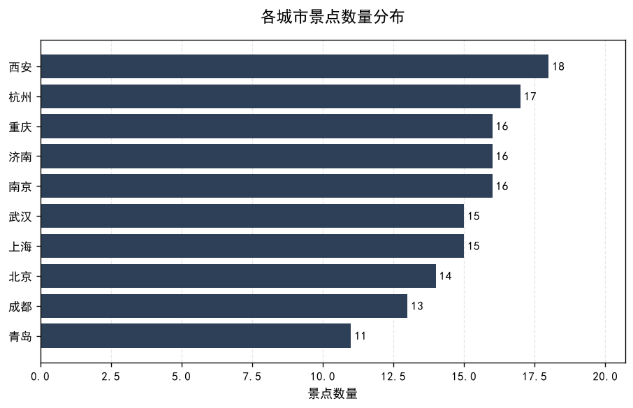

### 门票价格 vs 口碑评分

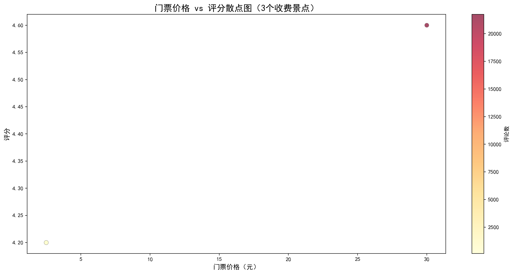

> 相关系数 r ≈ **−0.16**，说明"越贵越好"在本数据中**不成立**。

### 评论数最高的 15 个景点

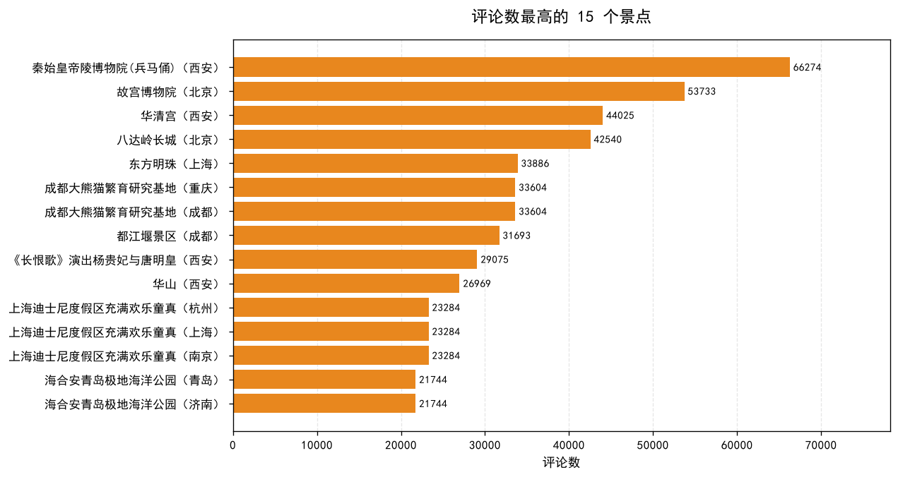

### 城市 × 景点类型 分布

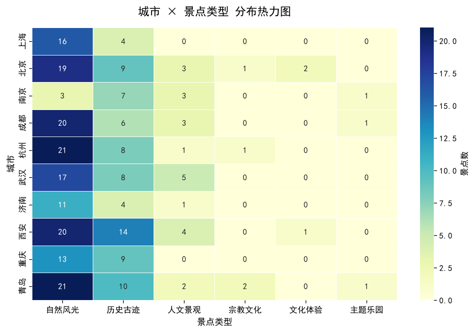

<details>
<summary><b>展开查看其余图表</b></summary>

| 图表 | 说明 |
|---|---|
| 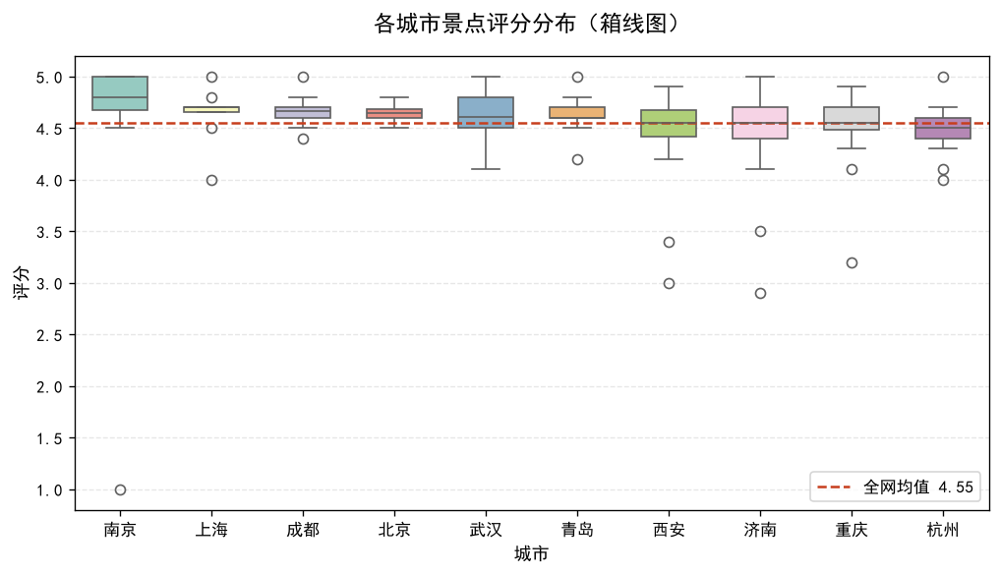 | 各城市评分分布（箱线图） |
| 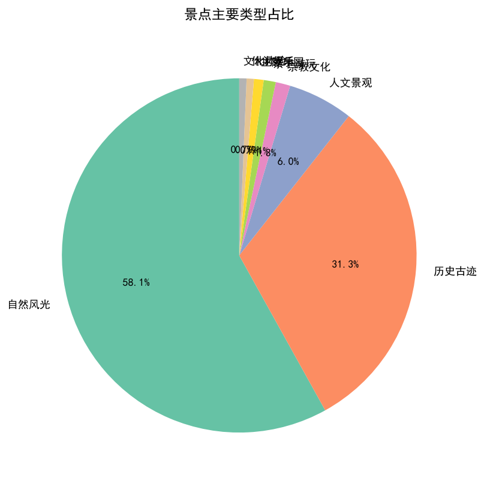 | 景点类型占比 |
| 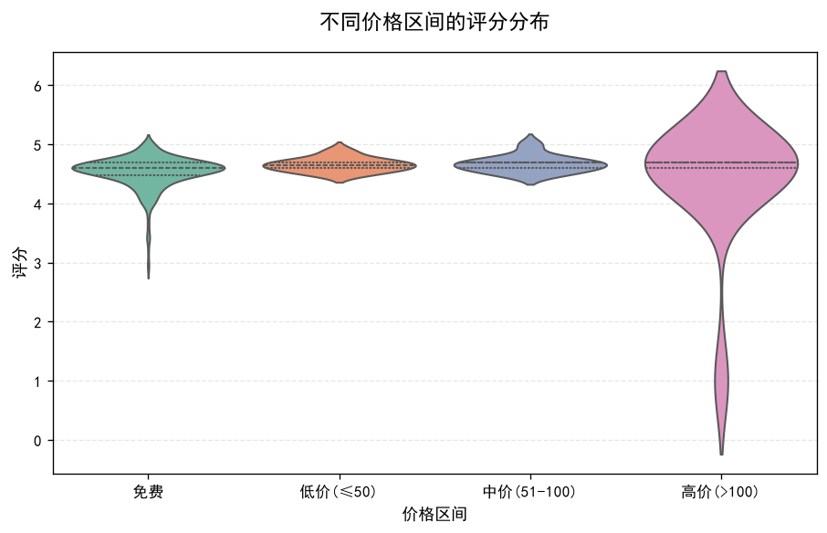 | 不同价格区间的评分分布 |
| 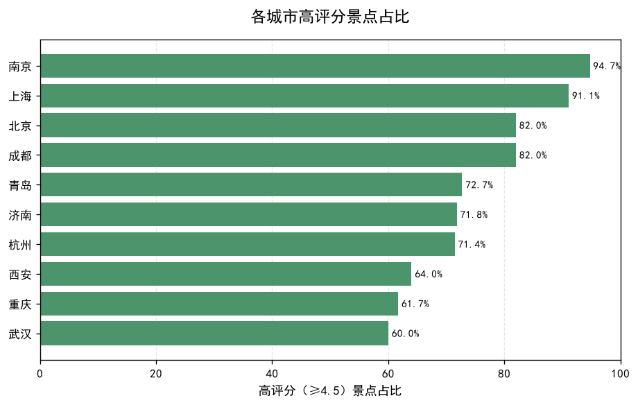 | 各城市高评分景点占比 |
| 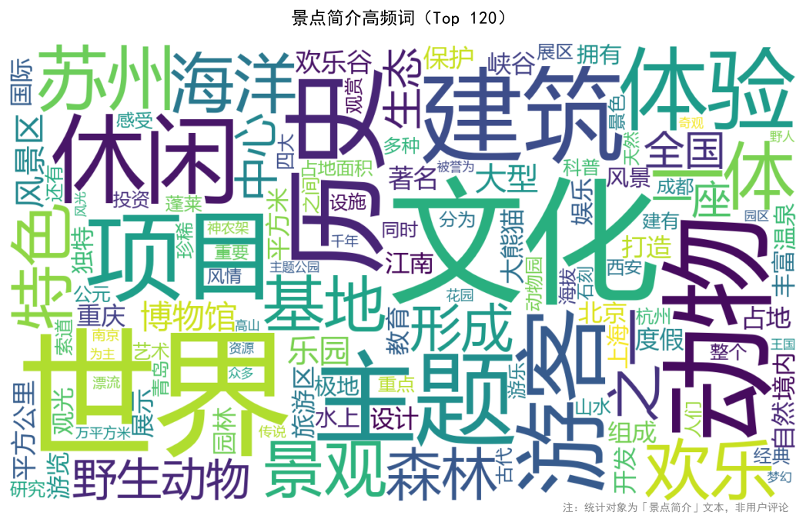 | 景点简介高频词 |
| 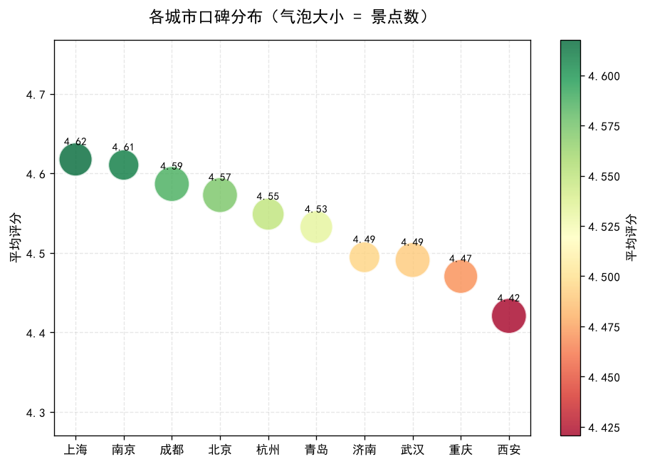 | 各城市口碑分布 |
| 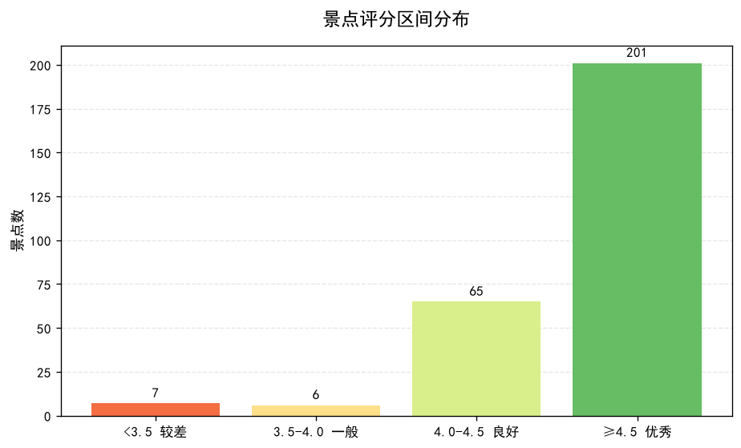 | 评分区间分布 |
| 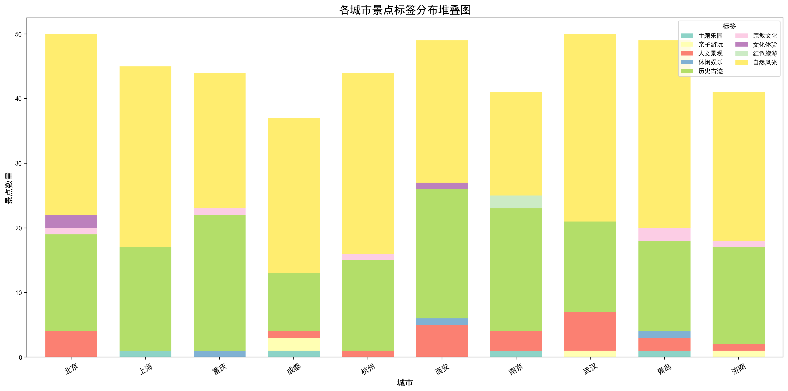 | 各城市价格区间构成 |

</details>

---

## 项目结构

```
city-attraction-analysis/
├── README.md
├── requirements.txt
├── data/
│   ├── raw/            # 原始爬取数据（scenic_spots_raw.xlsx，499 条）
│   └── processed/      # 清洗后数据 + 质量报告（455 条）
├── src/
│   ├── clean.py        # 数据清洗（跨城市污染检测 + 伪零分修正）
│   └── visualize.py    # 可视化（读清洗后数据出图）
└── results/
    └── figures/        # 12 张图表 + 1 个交互式地图（HTML）
```

---

## 后续计划

- [ ] 补充价格数据（换平台或增加采集量）以验证发现 1
- [ ] 基于真实评论构建 **RAG 问答**（"杭州哪个景点适合带孩子？"）
- [ ] 增加时间维度，分析口碑的季节性变化
